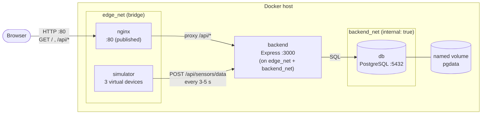

# IoT Sensor Monitoring Hub

> **Built and Documented with assistance from Claude (Anthropic)**
>
> *Created by Claude (Anthropic).*

A lightweight microservices project that simulates virtual IoT devices streaming telemetry (temperature, humidity, battery) into PostgreSQL and shows it live on a web dashboard. It runs entirely in Docker Compose and **needs no physical hardware**.

---

## Table of contents

1. [Overview & architecture](#1-overview--architecture)
2. [Project structure](#2-project-structure)
3. [Quickstart](#3-quickstart)
4. [Configuration](#4-configuration)
5. [API reference](#5-api-reference)
6. [Docker learning & experience log](#6-docker-learning--experience-log)
7. [AI development log](#7-ai-development-log)
8. [Deploying a live demo to GitHub Pages](#8-deploying-a-live-demo-to-github-pages)

---

## 1. Overview & architecture

| Service | Image / build | Role |
|---|---|---|
| `nginx` | `nginx:alpine` | Serves the dashboard and reverse-proxies `/api/*` to the backend. **The only published port (80).** |
| `backend` | `./backend` (Node.js 22 + Express, multi-stage) | REST API: ingest and query readings. |
| `db` | `postgres:alpine` | Stores `sensor_readings` in a persistent named volume. |
| `simulator` | `./simulator` (Node.js 22, zero dependencies) | Three virtual devices (`sensor-living-room`, `sensor-warehouse`, `sensor-kitchen`) POST a reading every 3-5 s. |

### Architecture diagram (Mermaid)



### Architecture diagram (ASCII)

```
                      +----------------------------------------------------+
                      |                    Docker host                     |
                      |                                                    |
  Browser  --:80-->   |  +--------+  /api/*   +---------+   SQL   +------+  |
  (dashboard)         |  | nginx  | --------> | backend | ------> |  db  |  |
                      |  +--------+           +---------+         +------+  |
                      |   static files             ^                  |     |
                      |   (./frontend)             | POST /api/       |     |
                      |                            | sensors/data     v     |
                      |                       +-----------+      [pgdata]   |
                      |                       | simulator |      named      |
                      |                       +-----------+      volume     |
                      |                                                    |
                      |  edge_net:    nginx, backend, simulator            |
                      |  backend_net: backend, db   (internal, no egress)  |
                      +----------------------------------------------------+
```

### Request flow

1. Each simulator device builds a realistic reading and calls `POST http://backend:3000/api/sensors/data` (Docker internal DNS, never leaves the host).
2. The backend validates the payload and inserts it into PostgreSQL.
3. The browser loads `index.html` from Nginx, then polls `/api/sensors/latest` (every 2 s) and `/api/sensors/history/:deviceId` (every 5 s). Nginx forwards those calls to the backend.

### Key design decisions

- **Two networks.** The database sits on an `internal` network that only the backend can reach, so it has no route to the internet and cannot be reached from Nginx or the simulator.
- **Health-gated startup.** `db` (pg_isready) -> `backend` (HTTP health) -> `nginx` and `simulator`. Nothing starts against a service that is not ready.
- **Same-origin API.** The browser only talks to Nginx, so there is no CORS configuration.
- **Skew-free freshness.** `/latest` returns `server_time`, so the dashboard decides whether a device is "stale" using the server's clock rather than the browser's.
- **Bounded storage.** A background job deletes readings older than `RETENTION_HOURS` (default 24).

---

## 2. Project structure

```
iot-sensor-hub/
├── docker-compose.yml        # services, networks, volume, healthchecks
├── .env.example              # optional overrides (copy to .env)
├── .gitignore
├── .github/
│   └── workflows/
│       └── deploy.yml        # publishes ./frontend to GitHub Pages (demo)
├── README.md
├── db/
│   └── init.sql              # schema, runs on first DB start
├── nginx/
│   └── nginx.conf            # static files + /api/ reverse proxy
├── backend/
│   ├── Dockerfile            # multi-stage, non-root
│   ├── .dockerignore
│   ├── package.json
│   └── src/
│       ├── server.js         # Express app, routes, validation, retention job
│       └── db.js             # pg pool + wait-for-db
├── simulator/
│   ├── Dockerfile
│   ├── .dockerignore
│   ├── package.json
│   └── simulator.js          # 3 virtual devices, mean-reverting random walk
└── frontend/
    └── index.html            # Tailwind (CDN) + Chart.js dashboard
```

---

## 3. Quickstart

### Prerequisites

- Docker Engine 24+ with the Compose plugin (`docker compose version`)
- Port `80` free on the host (or set `HTTP_PORT`, see below)
- Internet access in the **browser** (the dashboard loads Tailwind and Chart.js from CDNs)

### Run

```bash
# 1. (Recommended, once) pin backend dependency versions and commit the lockfile
( cd backend && npm install --package-lock-only )

# 2. (Optional) customise settings
cp .env.example .env

# 3. Build and start everything
docker compose up --build
```

Open **http://localhost** - three device cards appear within a few seconds. Click a card to change the chart's device.

Run in the background instead:

```bash
docker compose up --build -d
docker compose ps            # every service should be "healthy" / "running"
docker compose logs -f simulator backend
```

> **About the lockfile:** the backend `Dockerfile` uses `npm ci` when `backend/package-lock.json` exists (reproducible) and falls back to `npm install` when it does not, so the first build works either way. Step 1 above generates the lockfile; commit it.

> **Port 80 already in use?** `HTTP_PORT=8080 docker compose up --build`, then open http://localhost:8080.

### Test it

```bash
# Health (goes through Nginx -> backend -> PostgreSQL)
curl -s http://localhost/api/health

# Latest reading of every device (produced by the simulator)
curl -s http://localhost/api/sensors/latest

# History for one device, last 10 minutes, max 50 points
curl -s "http://localhost/api/sensors/history/sensor-kitchen?minutes=10&limit=50"

# Ingest a reading manually
curl -s -X POST http://localhost/api/sensors/data \
  -H 'Content-Type: application/json' \
  -d '{"device_id":"sensor-manual","temperature":21.5,"humidity":48.2,"battery":87}'

# Validation error (humidity out of range) -> HTTP 400
curl -s -i -X POST http://localhost/api/sensors/data \
  -H 'Content-Type: application/json' \
  -d '{"device_id":"x","temperature":20,"humidity":150,"battery":50}'

# Look at the data directly in PostgreSQL
docker compose exec db psql -U sensor_user -d sensors \
  -c "SELECT device_id, count(*), max(recorded_at) FROM sensor_readings GROUP BY device_id;"
```

A device you POST manually (e.g. `sensor-manual`) appears as a fourth card; it turns **Stale** after 15 s with no new readings.

### Verify persistence

```bash
docker compose down        # stops and removes containers, KEEPS the pgdata volume
docker compose up -d
# the dashboard history is still there

docker compose down -v     # -v also deletes the volume: all stored data is gone
```

### Stop / clean up

```bash
docker compose down                 # stop, keep data
docker compose down -v              # stop, delete data
docker compose down -v --rmi local  # also remove the locally built images
```

---

## 4. Configuration

All values are optional; defaults live in `docker-compose.yml`.

| Variable | Default | Used by | Purpose |
|---|---|---|---|
| `POSTGRES_USER` | `sensor_user` | db, backend | Database user (applied on first volume creation) |
| `POSTGRES_PASSWORD` | `change_me_in_env` | db, backend | Database password - **change it** outside a local demo |
| `POSTGRES_DB` | `sensors` | db, backend | Database name |
| `HTTP_PORT` | `80` | nginx | Host port for the dashboard |
| `RETENTION_HOURS` | `24` | backend | Delete readings older than this |
| `SIM_MIN_INTERVAL_MS` | `3000` | simulator | Minimum delay between readings per device |
| `SIM_MAX_INTERVAL_MS` | `5000` | simulator | Maximum delay between readings per device |

---

## 5. API reference

Base URL: `http://localhost/api` (through Nginx). All bodies are JSON.

| Method | Path | Description | Success |
|---|---|---|---|
| `GET` | `/api/health` | Liveness + database connectivity | `200` (`503` if DB down) |
| `POST` | `/api/sensors/data` | Ingest one reading | `201` |
| `GET` | `/api/sensors/latest` | Newest reading per device | `200` |
| `GET` | `/api/sensors/history/:deviceId` | Time series for one device, oldest first | `200` |

### `POST /api/sensors/data`

| Field | Type | Required | Rule |
|---|---|---|---|
| `device_id` | string | yes | 1-64 chars of `A-Z a-z 0-9 . _ -` |
| `temperature` | number | yes | -50 to 150 (°C) |
| `humidity` | number | yes | 0 to 100 (%) |
| `battery` | number | yes | 0 to 100 (%) |
| `recorded_at` | string | no | ISO 8601; defaults to server time |

Request:

```json
{
  "device_id": "sensor-kitchen",
  "temperature": 26.4,
  "humidity": 53.4,
  "battery": 62.5
}
```

Response `201 Created`:

```json
{
  "id": 1042,
  "device_id": "sensor-kitchen",
  "temperature": 26.4,
  "humidity": 53.4,
  "battery": 62.5,
  "recorded_at": "2026-10-16T02:30:12.481Z"
}
```

Response `400 Bad Request`:

```json
{
  "error": "validation_failed",
  "details": ["humidity must be a number between 0 and 100"]
}
```

### `GET /api/sensors/latest`

`server_time` is the server clock at response time (used by the dashboard to compute reading age).

```json
{
  "server_time": "2026-10-16T02:30:14.002Z",
  "count": 3,
  "readings": [
    { "id": 1040, "device_id": "sensor-kitchen",     "temperature": 26.4, "humidity": 53.4, "battery": 62.5, "recorded_at": "2026-10-16T02:30:12.481Z" },
    { "id": 1041, "device_id": "sensor-living-room", "temperature": 22.4, "humidity": 45.5, "battery": 85.1, "recorded_at": "2026-10-16T02:30:13.120Z" },
    { "id": 1039, "device_id": "sensor-warehouse",   "temperature": 15.1, "humidity": 61.5, "battery": 98.6, "recorded_at": "2026-10-16T02:30:10.904Z" }
  ]
}
```

### `GET /api/sensors/history/:deviceId`

| Query param | Default | Range | Meaning |
|---|---|---|---|
| `limit` | `100` | 1-1000 | Maximum number of points (the **newest** `limit` rows are returned) |
| `minutes` | none | 1-1440 | Only readings from the last N minutes |

Response (ordered oldest -> newest, ready for charting):

```json
{
  "device_id": "sensor-kitchen",
  "count": 2,
  "readings": [
    { "id": 1010, "device_id": "sensor-kitchen", "temperature": 26.1, "humidity": 54.0, "battery": 62.6, "recorded_at": "2026-10-16T02:30:04.100Z" },
    { "id": 1040, "device_id": "sensor-kitchen", "temperature": 26.4, "humidity": 53.4, "battery": 62.5, "recorded_at": "2026-10-16T02:30:12.481Z" }
  ]
}
```

### Errors

| Status | Body | Cause |
|---|---|---|
| `400` | `{"error":"validation_failed", ...}` | Invalid field or `deviceId` |
| `400` | `{"error":"invalid_json"}` | Malformed JSON body |
| `404` | `{"error":"not_found"}` | Unknown `/api/...` route |
| `413` | `{"error":"payload_too_large"}` | Body larger than 4 KB |
| `429/503` | Nginx default page | Rate limit (20 req/s per client, burst 40) / upstream unavailable |
| `500` | `{"error":"internal_error"}` | Unexpected server error (details are in the logs only) |

---

## 6. Docker learning & experience log

This section records the Docker concepts this project exercises, why each choice was made, and how to debug it.

### 6.1 Orchestration with Docker Compose

- **One file describes the whole system:** four services, two networks, one volume. `docker compose up --build` builds the two custom images and starts everything in dependency order.
- **`depends_on` with `condition: service_healthy`** is what makes startup reliable. Plain `depends_on` only waits for the container to *start*, not for PostgreSQL to *accept connections*. The chain here is `db` -> `backend` -> (`nginx`, `simulator`).
- **Healthchecks differ per service:**
  - `db`: `pg_isready -U $${POSTGRES_USER} -d $${POSTGRES_DB}`. The doubled `$$` stops *Compose* from substituting the variable on the host, so the shell *inside the container* expands it.
  - `backend`: a `node -e fetch(...)` call to `/api/health`, which itself runs `SELECT 1`. The Alpine image has no `curl`; using Node avoids installing extra packages.
  - `nginx`: `wget --spider http://127.0.0.1/`. `127.0.0.1` is used rather than `localhost` because `localhost` may resolve to IPv6 `::1`, where Nginx is not listening.
- **`init: true`** runs a tiny init process as PID 1 that forwards signals and reaps zombies. `restart: unless-stopped` recovers from crashes.
- **Defaults with overrides:** `${VAR:-default}` lets the stack start with zero configuration while still supporting a `.env` file.

### 6.2 Internal networking

- Compose creates a private DNS for each network, so services reach each other **by service name**: `backend` calls `db:5432`, the simulator calls `backend:3000`, Nginx proxies to `backend:3000`. No IP addresses are hard-coded, and containers on the same network need no published ports.
- **Two networks implement least privilege:**

  | Network | Members | Purpose |
  |---|---|---|
  | `edge_net` | nginx, backend, simulator | Traffic that arrives from the browser or the simulator |
  | `backend_net` (`internal: true`) | backend, db | Database access only; **no route to the internet** |

  The simulator and Nginx cannot talk to PostgreSQL at all.
- **Only Nginx publishes a port** (`80:80`). Anything else (backend `:3000`, database `:5432`) is unreachable from the host unless you deliberately add a `ports:` entry.
- **Nginx and DNS caching.** With a static `proxy_pass http://backend:3000`, Nginx resolves the hostname once at startup. If the backend container is recreated and gets a new IP, Nginx keeps using the old one and returns `502`. The fix used here is `resolver 127.0.0.11 valid=10s;` (Docker's embedded DNS) plus a **variable** in `proxy_pass` (`set $backend_upstream http://backend:3000;`), which forces re-resolution at request time. Because `proxy_pass` has no URI part, the original `/api/...` path is passed through unchanged.

### 6.3 Volume persistence

- `pgdata` is a **named volume** managed by Docker. It outlives containers: `docker compose down` removes containers and networks but keeps it. Only `down -v` (or `docker volume rm`) deletes the data.
- **`init.sql` runs only once.** Files in `/docker-entrypoint-initdb.d/` are executed when the data directory is *empty*. Editing `init.sql` later has no effect on an existing volume - run `docker compose down -v` to re-initialise (this deletes data), or apply a migration manually with `psql`.
- **`POSTGRES_USER/PASSWORD/DB` are also first-run only.** Changing the password in `.env` after the volume exists does not change the database's password.
- **Postgres 18+ data path.** Recent `postgres` images changed where the data directory lives. To work across versions, this project sets `PGDATA=/var/lib/postgresql/data` explicitly and mounts the volume one level up at `/var/lib/postgresql`.
- **Major-version upgrades.** `postgres:alpine` follows the newest major. A data directory created by an older major will not start under a newer one (error: *"database files are incompatible with server"*). For a real deployment, pin a tag such as `postgres:17-alpine` and upgrade deliberately (dump/restore or `pg_upgrade`).
- **Bind mounts vs. named volumes in this project:** `init.sql`, `nginx.conf` and `frontend/` are read-only (`:ro`) **bind mounts** so you can edit them on the host (refresh the browser to see frontend changes; `docker compose restart nginx` for config changes). Database files use a **named volume** because Docker manages ownership and performance for them.

### 6.4 Multi-stage builds and container hardening

`backend/Dockerfile` has two stages:

1. **`deps`** - copies `package.json` (+ lockfile) first, then runs `npm ci --omit=dev`. Copying manifests before source means this expensive layer is **cached** until dependencies change.
2. **`runtime`** - starts from a fresh `node:22-alpine`, copies only `node_modules` and `src/`, sets `NODE_ENV=production`, and switches to the unprivileged `node` user. The npm cache and install tooling from stage 1 never reach the final image.

Security measures in the images and Compose file:

| Measure | Where | Why |
|---|---|---|
| `USER node` | both Dockerfiles | A compromised process is not root inside the container |
| Alpine base | all images | Smaller image, smaller attack surface |
| `--omit=dev` + cache clean | backend | No dev tooling in production |
| `.dockerignore` | backend, simulator | Keeps `node_modules`, `.env`, `.git` out of the build context |
| `read_only: true` (+ `tmpfs: /tmp`) | backend, simulator | Container filesystem cannot be modified at runtime |
| `cap_drop: [ALL]` | backend, simulator | The apps need no Linux capabilities |
| `no-new-privileges` | all services | Blocks privilege escalation via setuid binaries |
| Exec-form `CMD ["node", ...]` | both Dockerfiles | Node receives `SIGTERM` directly and shuts down gracefully |
| Parameterised SQL, input validation, 4 KB body limit | backend | Prevents SQL injection and oversized payloads |
| Rate limiting, `server_tokens off`, security headers | nginx | Basic edge hardening |

The simulator has **no npm dependencies** (it uses Node's built-in `fetch`), so a second build stage would have nothing to discard; its Dockerfile is deliberately a single small stage.

Ideas to harden further: pin images by digest, add a Content-Security-Policy (needs self-hosted Tailwind/Chart.js instead of CDNs), run Nginx with `read_only` + a reduced capability set, store DB credentials as Compose `secrets`, add TLS termination.

### 6.5 Troubleshooting tips

| Symptom | Likely cause | Fix / what to check |
|---|---|---|
| `bind: address already in use` on port 80 | Another service owns port 80 | `HTTP_PORT=8080 docker compose up` |
| `backend` stays `unhealthy` or restarts | DB not ready, wrong credentials, or old volume with different password | `docker compose logs db backend`; if the password changed, `docker compose down -v` (deletes data) |
| `password authentication failed for user` | `.env` changed after the volume was created | Revert the value, or `docker compose down -v` |
| `database files are incompatible with server` | `postgres:alpine` moved to a newer major than the volume | Pin the previous major tag, or recreate the volume |
| Dashboard loads but is empty | Simulator not running/healthy | `docker compose ps`; `docker compose logs simulator` |
| Cards show but charts are blank + yellow warning | Browser cannot reach the Chart.js CDN | Check internet access / ad-blocker; cards still work |
| Page unstyled | Tailwind CDN blocked | Same as above |
| `502 Bad Gateway` on `/api/*` | Backend down or restarting | `docker compose logs backend`; wait for `healthy` |
| `502` right after recreating the backend | Stale DNS in Nginx (only if you replace the variable-based `proxy_pass`) | Keep the `resolver` + variable pattern, or `docker compose restart nginx` |
| `init.sql` changes ignored | Volume already initialised | `docker compose down -v`, then `up` |
| Edited `nginx.conf` but nothing changed | Config is read at start | `docker compose restart nginx` (validate with `docker compose exec nginx nginx -t`) |
| Code change not reflected in backend/simulator | Old image still used | `docker compose up --build` (or `docker compose build --no-cache backend`) |
| `EACCES` writing files in the container | `read_only: true` is enabled | Write to `/tmp` (tmpfs) or add a dedicated volume |
| Build fails on `npm ci` | Lockfile out of sync with `package.json` | `cd backend && npm install --package-lock-only` and rebuild |
| Disk fills up over time | Old images, build cache, unused volumes | `docker system df`, `docker builder prune`, `docker image prune` |

Handy commands:

```bash
docker compose ps                               # status + health
docker compose logs -f --tail=50 backend        # follow one service
docker compose exec backend sh                  # shell in a running container
docker compose exec db psql -U sensor_user -d sensors
docker inspect --format '{{json .State.Health}}' $(docker compose ps -q backend)
docker network inspect iot-sensor-hub_backend_net
docker volume inspect iot-sensor-hub_pgdata
docker compose config                           # fully resolved configuration
docker compose up -d --scale simulator=2        # (note: two simulators = duplicate device IDs)
```

---

## 7. AI development log

This project was designed and written in a single working session with **Claude (Anthropic)**, acting in the role of a senior DevOps engineer and full-stack architect.

### 7.1 Prompt workflow

1. **One structured brief.** The prompt stated the objective (IoT hub with simulated devices), a numbered architecture (Nginx, PostgreSQL, backend API, simulator, dashboard), explicit deliverables (directory tree, configs, runnable code, README) and a role ("senior DevOps engineer"). A precise brief produced a coherent first pass.
2. **Design before code.** Claude first settled the service boundaries, the two-network topology, the startup order (health-gated) and the API contract, then wrote files in dependency order: database schema -> backend -> Nginx -> simulator -> frontend -> Compose -> README.
3. **Decisions where the brief left a choice.** Node.js/Express was picked over FastAPI (one language across backend, simulator and dashboard; small Alpine image). The simulator uses Node's built-in `fetch` so it needs no dependencies.
4. **Verify what can be verified.** Checks were run in the build workspace (see 7.3), and the limits of those checks are stated explicitly instead of assumed away.
5. **Iterate on findings.** Problems found while building changed the design (7.2).

### 7.2 Notable decisions and corrections made during the session

| Finding | Resolution |
|---|---|
| The workspace could not reach the npm registry, so `package-lock.json` could not be generated | The backend `Dockerfile` accepts an optional lockfile (`package-lock.json*`) and uses `npm ci` when present, `npm install` otherwise; the Quickstart tells you to generate and commit the lockfile |
| Browser clock vs. server clock could make live devices look "stale" | `/api/sensors/latest` returns `server_time`; the dashboard computes reading age against it |
| `postgres:alpine` data-path behaviour differs between major versions | Explicit `PGDATA` and a volume mounted at `/var/lib/postgresql` |
| Static `proxy_pass` hostnames are resolved once by Nginx | `resolver 127.0.0.11` + variable `proxy_pass` so a recreated backend is picked up |
| The dashboard must not trust data it renders | All dynamic text is written with `textContent` (never `innerHTML`); device IDs are also validated server-side |

### 7.3 Verification status

Be aware of what was and was not tested when this was generated:

| Check | Result |
|---|---|
| `docker compose config` (Compose file is valid) | Passed |
| `node --check` on backend, simulator and the dashboard's inline script | Passed |
| Simulator run against a stub HTTP server: three devices posted readings with valid, in-range payloads | Passed |
| `docker compose up --build` end to end (image builds, healthchecks, Nginx proxying) | **Not run** - no Docker daemon was available in the build workspace |
| Backend against a real PostgreSQL (SQL queries, constraints, retention job) | **Not run** - no database server available |
| Dashboard demo-mode engine (Node test with stubs: 3 devices, ~900 points/hour, valid ranges, ascending order, live tick) | Passed |
| `.github/workflows/deploy.yml` parses as valid YAML | Passed |
| Dashboard rendering in a browser (Docker mode and GitHub Pages demo mode) | **Not run** |
| The GitHub Pages deployment itself | **Not run** - needs your repository |

**Please run this smoke test on your machine** and fix anything it reveals:

- [ ] `docker compose up --build` completes; `docker compose ps` shows `db`, `backend`, `nginx` as healthy
- [ ] `curl http://localhost/api/health` returns `{"status":"ok","database":"up",...}`
- [ ] After ~10 s, `curl http://localhost/api/sensors/latest` lists three devices
- [ ] http://localhost shows three live cards and two charts that grow over time
- [ ] The manual `POST` example creates a fourth card; the invalid example returns `400`
- [ ] `docker compose down` then `up -d` keeps history; `down -v` clears it

### 7.4 Lessons about working with an AI on infrastructure

- **Be specific about structure and deliverables;** vague prompts produce generic scaffolding. Naming the ports, endpoints, tables and file names removed guesswork.
- **Ask for the reasoning, not just the files.** The learning log exists because the brief asked for documentation of *why*.
- **Treat generated configuration as a draft that must be run.** Static checks catch syntax, not behaviour; healthchecks, volumes and networking only prove themselves at runtime.
- **Version-sensitive details deserve a second look** (image tags, data paths, CDN versions). Pin versions and re-check them against current documentation.
- **Keep the human in the loop for security-relevant defaults** such as the demo database password and exposed ports.

### 7.5 Your own notes

Add your hands-on experience here: what you ran, what failed, how you fixed it, and what you would change.

```
- Date / environment (OS, Docker version):
- Problems hit and how they were solved:
- What I would improve next:
```

---

## 8. Deploying a live demo to GitHub Pages

GitHub Pages serves **static files only**. It cannot run Docker, Nginx, the Node.js API or PostgreSQL, so the full stack stays a local/server deployment. What you *can* publish is the dashboard in `frontend/`, and it ships with a **demo mode** that simulates the three sensors inside the visitor's browser.

| | Full stack (`docker compose up`) | GitHub Pages demo |
|---|---|---|
| Data source | Simulator container -> API -> PostgreSQL | JavaScript in the page (same device model) |
| Persistence | Yes (named volume) | No - resets on reload |
| Backend / DB | Yes | No |
| URL | `http://localhost` | `https://<user>.github.io/<repo>/` |

### How demo mode is chosen

The dashboard uses demo mode when any of these is true: the URL contains `?demo=1`, the page is served from `*.github.io`, it is opened as a `file://` page, or the host returns `404` for `/api/health` (a static host with no backend). `?demo=0` forces the real API. A `502/503` from a Docker stack that is still starting does **not** switch to demo mode. In demo mode an amber banner is shown and the status reads "Live (demo)".

### Files involved

- `.github/workflows/deploy.yml` - on every push to `main` that touches `frontend/**`, uploads the `frontend` folder and deploys it. No build step is needed (plain HTML + CDN scripts).
- `frontend/index.html` - contains the demo engine. There is no client-side routing and the page uses no local asset paths, so no `base` setting, `404.html` or HashRouter is required.

### Steps

1. Create a GitHub repository whose **root is this project folder** (so `.github/` and `frontend/` sit at the top level) and push it to the `main` branch.
2. Repo -> **Settings** -> **Pages**.
3. **Build and deployment** -> **Source**: choose **GitHub Actions**. Nothing else to save.
4. Open the **Actions** tab. The push starts "Deploy dashboard to GitHub Pages"; if it did not, select it and click **Run workflow**.
5. When the run is green, open `https://<user>.github.io/<repo>/` (also shown in the job summary and at the top of Settings -> Pages).

### Troubleshooting

| Symptom | Fix |
|---|---|
| No "GitHub Actions" source option, or Pages unavailable | Private repositories need a paid GitHub plan for Pages; otherwise make the repository public |
| `Branch "main" is not allowed to deploy to github-pages` | **Settings** -> **Environments** -> **github-pages** -> allow `main` |
| Workflow did not run | The push must touch `frontend/**` or the workflow file; or start it manually with **Run workflow** |
| Page loads but charts are empty with a yellow warning | The visitor's browser cannot reach the Chart.js CDN |
| Page unstyled | The Tailwind CDN is blocked |
| Deprecation warnings about action versions | Bump each action in `deploy.yml` to its latest major version |
| Pages URL shows the repository README or a 404 | Source is not set to **GitHub Actions**, or the workflow has not finished |

### Showing real data instead of the demo

Pages is HTTPS and cross-origin, so pointing the published dashboard at a backend you host elsewhere would also require HTTPS on that backend and CORS support in `backend/src/server.js`. Neither is included in this project.

---

*Built and Documented with assistance from Claude (Anthropic). Created by Claude.*
